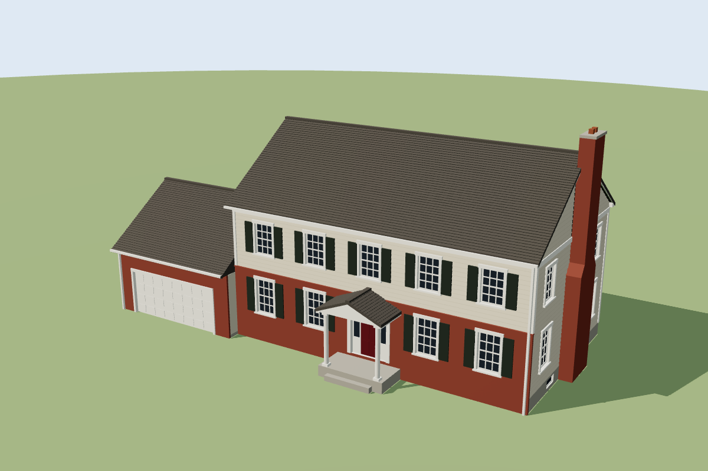

# 1:100 Colonial House Model

A printable exterior model of a two-story colonial with an attached two-car garage. It is about 46 × 28.5 ft (2,622 sq ft over two floors) and comes out **215 × 112 × 104 mm** at 1:100.



All views: [`previews/contact_sheet.png`](previews/contact_sheet.png)

## Files

| File | What it is |
|---|---|
| `house_print_parts.3mf` | **Print this one.** Three objects (house body, main roof, garage roof) laid flat on one plate (218 × 213 mm). None of them need supports. |
| `house_assembled.3mf` | The whole house as one solid. Good for viewing. To print it in one piece you need supports under the eaves. |
| `generate_house.py` | The parametric source. Change a dimension and re-run it to regenerate both files. |
| `previews/` | Renders from every side, made from the exported 3MF. |

Both 3MF files carry per-face display colors (brick, siding, trim, shutters, roof, glass and so on) and a thumbnail.

## Printing the parts version

- **Bed size:** the plate fits a 256 × 256 mm bed (Bambu A1/P1/X1). On a 250 × 210 mm bed (Prusa MK4), move the main roof onto a second plate.
- **Body:** prints upright. The only bridge is the porch ceiling, about 15 mm.
- **Roofs:** print flat side down.
- **Settings:** a 0.4 mm nozzle at 0.12–0.16 mm layers keeps the window grilles (about 0.4 mm) and the siding and shingle lines crisp.
- **Locating pins:** each roof has two 2 mm × 4 mm holes that line up with matching holes on top of the walls. Cut four ~7 mm pieces of 1.75 mm filament as pins. Glue is optional, so the roof can come off.

## Assumptions

No photos, floor plans or street imagery were available for this house. So this is a typical late-1980s Michigan builder colonial at the house's recorded size, not a photo match. These are guesses:

- garage on the left, projecting 2 ft forward
- brick first-floor front
- five-bay window layout
- gable portico
- exterior chimney on the right gable
- 8/12 roof pitch
- rear slider

Everything is in feet near the top of `generate_house.py` and in `body()`, so it's quick to move a window, flip the garage side or change the pitch.

## Regenerating

```bash
pip install numpy manifold3d
python generate_house.py [thumbnail.png]
```
